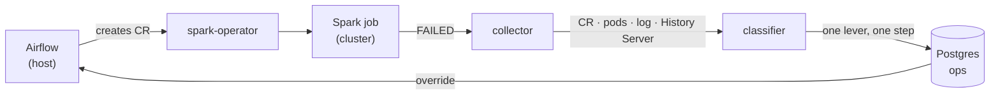

# spark-auto-remediation

Classifies why a Spark job failed, adjusts the one setting that matches the cause, and
re-runs it through Airflow.

> Experimental. Not run in production.

## Features

- Classifies failures from outside the job: SparkApplication CR, pod exit codes, driver
  log, Spark History Server
- 14 error types and 15 remediation rules, stored in Postgres
- One lever, one step per attempt — no blind memory doubling
- Does not retry failures that configuration cannot fix
- Automatic re-run through Airflow (`retry_policy`), no human involvement
- Works on jobs it did not submit and failures it does not recognise
- Six failure-reproduction jobs for development and testing

## Architecture



Airflow runs on the host and creates the `SparkApplication` CR through the Kubernetes API;
the cluster's spark-operator runs the job. On failure the judgment runs inside Airflow's
`retry_policy`, writes one override to Postgres, and the next attempt submits with it.

## Requirements

| | |
|---|---|
| Docker | ~8 GiB available to containers |
| [k3d](https://k3d.io) | 5.9+ |
| kubectl, helm | |
| Python | 3.10–3.14 (3.13 pinned) |
| Disk | ~10 GiB free |

## Installation

```sh
cp .env.example .env
make up
```

`make up` creates the k3d cluster and deploys MinIO, Postgres, spark-operator, the Spark
History Server, and the `ops` schema.

Then install Airflow and the project dependencies into a single venv:

```sh
python3.13 -m venv .venv
.venv/bin/pip install "apache-airflow[cncf-kubernetes,postgres]==3.3.2" \
  --constraint "https://raw.githubusercontent.com/apache/airflow/constraints-3.3.2/constraints-3.13.txt"
.venv/bin/pip install duckdb        # for data generation only
make airflow-up
```

The Airflow UI is at `http://localhost:8081`. Full setup, including the metadata database
and the Kubernetes connection: [`infra/airflow/README.md`](infra/airflow/README.md).

Finally generate the source data the jobs read:

```sh
make data           # TPC-DS (SF=1) and synthetic data
```

This writes Parquet and CSV to MinIO `landing/` and a table to Postgres `source`. It takes
a few minutes and is idempotent — pass `SF=` for a different TPC-DS scale factor.

## Usage

Trigger a DAG from the Airflow UI, or from the command line:

```sh
. infra/airflow/env.sh
.venv/bin/airflow dags trigger spark_udf_oom_killed
```

The job fails, is classified, and is re-run with an adjusted setting until it succeeds or
until a stop condition is reached.

### Make targets

```
make up                  cluster and base services
make down                delete the cluster
make status              cluster and service status
make airflow-up          start Airflow on the host
make airflow-down        stop Airflow
make airflow-status       Airflow processes and API
make job JOB=<name>      submit one job by hand, without a DAG
make classify [APP=...]  collect and classify failures
make reclassify          re-classify stored failures, print differences only
make failures            list stored failures and suggestions
make data                generate source data (TPC-DS + synthetic)
make image               build the Spark image and load it into the cluster
```

`make help` lists every target, including the sub-steps of `make up`.

## Configuration

| File | Contents |
|---|---|
| `.env` | credentials (MinIO, Postgres, Airflow metadata DB) |
| `faults/jobs.yaml` | failure-reproduction job settings |
| `infra/airflow/env.sh` | Airflow environment variables |
| `infra/k3d/cluster.yaml` | cluster shape and node memory |
| `infra/sql/02-ops-seed.sql` | error types and remediation rules |

Remediation rules are in Postgres, not in code. Edit them with SQL:

```sql
UPDATE remediation_rules SET steps = '["512m","1g","2g"]' WHERE error_code = 'heap';
```

## Project structure

```
remediator/     collector, classifier, judgment
dags/           Airflow DAGs — one per job
infra/          cluster, manifests, SQL schema, Airflow setup
images/spark/   Spark image
faults/         failure-reproduction jobs and their settings
data/           source data generation (DuckDB)
```

## Versions

| Component | Version |
|---|---|
| Spark | 4.1.4 |
| Airflow | 3.3.2 |
| apache-airflow-providers-cncf-kubernetes | 10.22.0 |
| kubeflow spark-operator | chart 2.5.2 |
| k3s / k3d | v1.34.12-k3s1 / 5.9.0 |
| PostgreSQL | 18 (cluster) / 16.15 (Airflow metadata) |
| Python | 3.13.13 |
